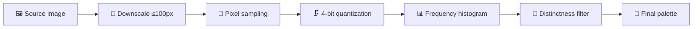

# 🎨 PaletteSnap

> Extract stunning, designer-grade color palettes from any image — entirely in the browser. No uploads, no servers, no tracking.

**🚀 Live demo:** https://alikali68.github.io/palettesnap/


---

## ✨ Features

| Feature | Details |
|---------|---------|
| 🖼️ Universal upload | Drag & drop or browse — PNG, JPG, WEBP, AVIF, SVG |
| ✨ Instant sample | One click generates vivid abstract artwork in-canvas — zero external assets |
| 🎯 Smart extraction | Dominant-color engine (see *The Science* below) |
| 📋 One-click copy | Click any swatch → HEX copied with toast confirmation · hover reveals RGB |
| 🔢 Palette density | 4 / 6 / 8 / 10 colors, re-extracted live from the source image |
| 💾 Dual export | CSS custom properties **or** a 1200×630 PNG palette card |
| 🌙 Premium dark UI | Glassmorphism, Space Grotesk + Inter, responsive from mobile to desktop |
| ♿ Considerate | `prefers-reduced-motion` respected · contrast-aware swatch labels |

---

## 🧠 The Science — how the extraction engine works

PaletteSnap doesn't guess — it *measures*. Every pixel of your image votes, and only the most representative colors survive.

### Pipeline



### 1. 📐 Intelligent downsampling
The image is drawn to an offscreen canvas capped at **100px** on the longest side. A 4000×3000 photo (12M pixels) collapses to ~7.5K pixels — a **~1600× speedup** — while the *statistical color distribution* stays virtually identical. The same trick production thumbnail pipelines use.

### 2. 🔬 Pixel sampling
Raw RGBA data is read via `getImageData`. Near-transparent pixels (alpha < 128) are discarded — they carry no meaningful color and would pollute the histogram.

### 3. 🗜️ Color quantization (4-bit)
Each channel (0–255) is compressed to 4 bits (16 levels), collapsing 16.7M possible colors into **4,096 bins**. Why? The human eye can't distinguish `#A3B18A` from `#A4B189` at a glance — quantization merges imperceptible neighbors so *true* dominant tones emerge instead of noise.

### 4. 📊 Frequency histogram
A `Map` counts votes per bin in **O(n)** — a single pass, no pixel sorting. Bins are ranked by frequency: the colors your image *actually* contains most of rise to the top.

### 5. 🧲 Perceptual distinctness filter
Top-frequency colors are often near-duplicates (ten shades of blue sky). Each candidate is tested against already-selected colors with **Euclidean distance in RGB space** — anything closer than **Δ = 40** is rejected. A graceful fallback fills remaining slots with the next-best colors, so you always get exactly the count you asked for.

### 6. 🌗 Luminance-aware rendering
Swatch labels use the **relative luminance** formula (`0.2126R + 0.7152G + 0.0722B`) to choose dark or light text automatically — readable on *every* extracted color, zero manual tweaking.

---

## 🏗️ Architecture

Zero-dependency, single-file architecture. One `index.html` — open it and it runs.

```
index.html
├── <head> ── Tailwind CDN · Google Fonts · design tokens
├── <body>
│   ├── Header         → brand + reset action
│   ├── Upload stage   → dropzone · file input · sample-art trigger
│   ├── Result stage   → control bar · image preview · swatch grid
│   ├── Toast system   → clipboard / export feedback
│   └── Footer
└── <script>
    ├── CONFIG         → tuning constants (sample size, Δ threshold, export dims)
    ├── STATE          → current image · palette array · selected count
    ├── DOM            → cached element references (zero repeated queries)
    ├── EXTRACTION     → downscale · quantize · histogram · distinctness filter
    ├── RENDER         → swatch cards · contrast-aware labels · animations
    ├── EXPORT         → CSS-variables serializer · PNG card renderer
    └── EVENTS         → drag & drop · buttons · count toggle
```

**Data flow:** `upload → Image object → offscreen canvas → palette[] → render + export`.
The palette array is the single source of truth — swatches, CSS export, and PNG export all derive from it.

---

## ⚡ Performance

| Operation | Complexity | Notes |
|-----------|-----------|-------|
| Downscale | O(1) GPU | Browser-native `drawImage` |
| Sampling | O(p), p ≤ ~10K px | Capped by the 100px budget |
| Histogram | O(p) | Single pass into a `Map` |
| Ranking | O(b log b), b ≤ 4096 | Sorts bins, not pixels |
| Distinctness | O(k²), k ≤ 10 | Negligible |

Result: **instant** extraction on any device — even a mid-range phone.

---

## 🛠️ Tech stack

- **HTML5** — semantic structure
- **Vanilla JavaScript (ES6+)** — zero framework overhead
- **Tailwind CSS (CDN)** — utility-first styling
- **Canvas 2D API** — sampling, sample-art generation, PNG export
- **Google Fonts** — Space Grotesk + Inter

## 🚀 Run it

No install. No build. Just open `index.html` — or use the live demo above.

## 🔮 Roadmap

- [ ] Copy as Tailwind config / SCSS variables
- [ ] Palette harmony analysis (complementary / analogous detection)
- [ ] Contrast-ratio checker between swatch pairs
- [ ] Shareable palette via URL hash

---

<p align="center">Crafted for designers & developers 🎨</p>

---
